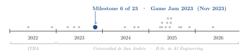
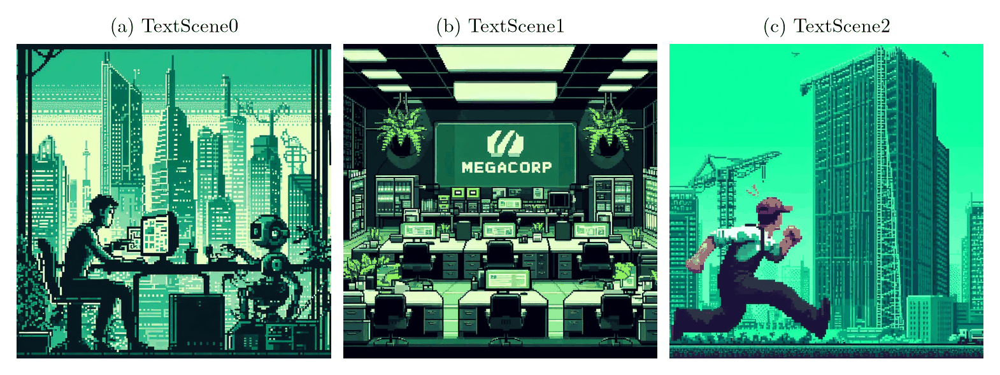
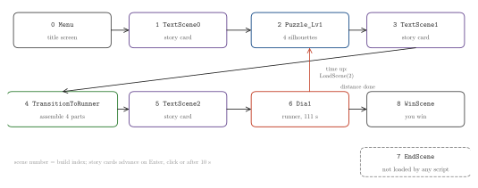
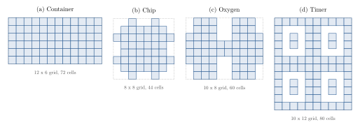
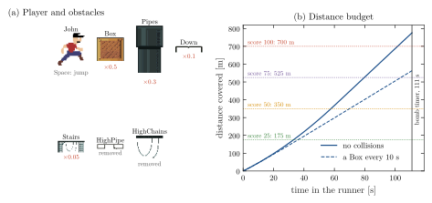

<div align="center">

# Assembly Rush: A Puzzle-to-Runner Game Made in a Weekend Game Jam

**Santiago Groba Alonso** · [Facundo Viñas Canale](https://github.com/FacuVCanale) · [Juan Francisco Lebrero](https://github.com/frizynn) · [Lucas Ercolano](https://github.com/LucasErcolano)

Team GameWiz · *ITBA Computer Society Game Jam 2023* · November 2023 · Extracurricular

[](#running-the-project)
[](#running-the-project)
[](LICENSE)

<picture>
  <source media="(prefers-color-scheme: dark)" srcset="docs/figures/trajectory-dark.svg">
  
</picture>

</div>

> **Abstract.** *Assembly Rush* is a 2D Unity game written by a team of four over one weekend (3–5 November 2023) for the ITBA Computer Society Game Jam. John, a new employee of the secretive MegaCorp, spends his first days fitting parts together, discovers that he has assembled a bomb, and has to run out of the building before it goes off. The game chains two genres to tell that story: a Tetris-like puzzle in which drifting pieces are locked onto four silhouettes (a container, a chip, an oxygen tank and a timer), and a side-scrolling runner against a 111-second bomb timer. The two halves are coupled: the average fill percentage of the puzzle sets the distance of the escape, at 7 m per point. Replaying the runner's speed rule from the source code shows that an uninterrupted run covers 775.6 m in 111 s, so even a perfect puzzle (700 m) can be escaped with about 9 s to spare, while hitting a box every 10 s caps the run at 563 m.

<p align="center"></p>

---

## 1. Concept

A game jam gives a fixed weekend to go from an empty project to something playable. The team's answer was a short, story-driven game in three acts, each separated by a story card:

1. **Puzzle.** Pieces enter the frame from a random wall and drift one cell per step. The player shifts them sideways with the arrow keys, rotates them with Space and locks them with Enter. Each silhouette receives 25 pieces; the score of a silhouette is the percentage of its cells that ended up covered.
2. **Assembly.** The four finished parts are dragged onto their slots on a workbench. When the last one snaps into place a countdown sound plays and the story reveals what was built.
3. **Escape.** John runs to the right automatically and jumps with Space. Obstacles on the ground slow him down; overhead obstacles are removed on contact. He wins if he covers the required distance before the bomb timer reaches zero.

## 2. Design and implementation

| Component | Choice |
|---|---|
| Engine | Unity 2022.3.12f1, 2D, C# scripts, TextMesh Pro for all text |
| Scene flow | Nine scenes in build order; most transitions call `SceneManager.LoadScene(buildIndex + 1)`; story cards advance on Enter, a click or after 10 s |
| Puzzle grid | Each silhouette is an `int[x, y]` matrix built in code (`ShadowsArrays/*.cs`): `0` = cell to fill, `-1` = outside the shape; locking a piece maps every child block to a cell |
| Puzzle score | Fill percentage per silhouette, averaged over the four silhouettes (`ScoreManager`) |
| Assembly | Drag-and-drop with snap-to-slot within 3 world units (`PuzzlePiece`, `PuzzleSlot`) |
| Runner | `Rigidbody2D` jump on Space; one spawner for ground obstacles every 1.4–2 s and one for overhead obstacles every 3–5 s |
| Runner speed | scroll speed $v = \min(2.5 + t/8,\ 10)$, distance rate $3 + v/2$ m/s, where $t$ is the time since the run started |
| Collisions | A ground obstacle multiplies $t$ by a factor (Box 0.5, Pipes 0.3, Down 0.1, Stairs 0.05), which lowers the speed; a factor of 0.05 almost resets it |
| Coupling | Distance to run $= 7 \times$ puzzle score; bomb timer 111 s (`GameManager`) |

**Table 1.** Main areas of each team member, as recorded in the commit history.

| Member | Main areas |
|---|---|
| Santiago Groba Alonso | Puzzle-level UI and on-screen messages, piece rotation, the assembly scene (`TransitionToRunner`), music |
| Facundo Viñas Canale | Puzzle mechanics: piece spawning and movement, silhouette grids, fill scoring and level progression |
| Lucas Ercolano | Runner: player controller, obstacles and collision penalties, camera, animations, puzzle-score connection |
| Juan Francisco Lebrero | Main menu, win and end scenes, start–lose–restart loop, runner sprites |

## 3. Results

### 3.1 Story and scene flow

<p align="center"></p>

**Figure 1.** Backgrounds of the three story cards, in the order they appear: (a) John at his desk next to a robot, (b) the MegaCorp office, (c) the escape.

<p align="center"></p>

**Figure 2.** Scene flow as coded. Numbers are build indices. Running out of time in the runner loads scene 2, which restarts from the puzzle; the end scene exists in the build but no script loads it.

### 3.2 Puzzle

<p align="center"></p>

**Figure 3.** The four silhouettes in the order they are played, drawn from the matrices in `Assets/Puzzle/Shadows/ShadowsArrays/`. Shaded cells are the ones to fill; the dotted rectangle is the bounding grid. The timer's four holes form the digits of a clock display.

The silhouettes range from 44 cells (chip) to 80 cells (timer), and all of them get the same budget of 25 pieces. A block that lands on a `-1` cell or outside the grid fills nothing; the script only counts it as an error.

### 3.3 Runner

<p align="center"></p>

**Figure 4.** (a) The player sprite and the six obstacle prefabs that the spawners use, with the factor each ground obstacle applies to the speed timer. (b) Distance covered against time, computed by replaying `GameManager.Update` frame by frame at 60 fps. Dotted lines are the distances required by different puzzle scores; the dashed curve assumes a collision with a box every 10 s.

**Table 2.** Time needed to cover the escape distance, from the same replay (not measured in play).

| Puzzle score | Distance | No collisions | Box every 10 s |
|---:|---:|---:|---:|
| 25 | 175 m | 33.1 s | 36.1 s |
| 50 | 350 m | 57.8 s | 69.9 s |
| 75 | 525 m | 79.7 s | 103.8 s |
| 100 | 700 m | 101.6 s | not reached (563.1 m at 111 s) |

The speed reaches its cap of 10 after 60 s of uninterrupted running, so the late part of the run dominates the distance. That is why a few collisions cost so much: each one sends the speed back toward its starting value and the player has to earn the acceleration again.

## 4. Takeaways

- Splitting the game into scenes with a fixed build order let four people work in parallel on separate branches (puzzle, runner, menus, assembly) and merge on the last day.
- Coupling the two halves through one number (the puzzle score) is a cheap way to make a two-genre game feel like a single story, but the coupling deserves tuning: as coded, a better puzzle means a longer escape.
- A small replay of the update loop (Figure 4b) is enough to check difficulty without playing: it shows how much slack the 111-s timer leaves at each score.

## Running the project

1. Install Unity Hub and the editor version in `ProjectSettings/ProjectVersion.txt` (2022.3.12f1).
2. *Add project from disk* and select the repository folder; Unity regenerates `Library/` on first open.
3. Open `Assets/Scenes/Menus/Menu.unity` and press Play, or build from *File → Build Settings*, where the nine scenes are already listed in order.

The figures and the numbers in Table 2 are regenerated with:

```bash
pip install numpy matplotlib pillow
python docs/figures/make_figures.py   # prints silhouette sizes and the runner replay
```

| Path | Content |
|---|---|
| `Assets/Scenes/` | The nine scenes: menu, story cards, puzzle, assembly, runner (`Dia1`), win and end scenes |
| `Assets/Puzzle/` | Puzzle pieces, spawners, silhouettes (`Shadows/`), score and spawn managers |
| `Assets/Scripts/` | Runner and menus: `GameManager`, `John`, `ObstacleSpawner`, `MainMenu`, `RestartGame`, music control |
| `Assets/Prefabs/`, `Assets/Animations/` | Obstacle prefabs and their idle / destroyed animations |
| `Assets/Files/`, `Assets/Sprites/` | Sprites, backgrounds and story-card illustrations |
| `Assets/Sounds/`, `Assets/Music/` | Music and sound effects |
| `banner.png` | Title art |
| `docs/figures/` | Script and style used for the figures in this README |

This repository is a fork of the team's original repository, [FacuVCanale/assembly-rush-game](https://github.com/FacuVCanale/assembly-rush-game).

## Acknowledgements

Thanks to the ITBA Computer Society for organizing the game jam. The `TextMesh Pro` folder contains Unity's TextMesh Pro package resources and examples.

## Citation

```bibtex
@misc{gamewiz2023assemblyrush,
  author       = {Groba Alonso, Santiago and Vi{\~n}as Canale, Facundo and Lebrero, Juan Francisco and Ercolano, Lucas},
  title        = {Assembly Rush: A Puzzle-to-Runner Game Made in a Weekend Game Jam},
  year         = {2023},
  howpublished = {ITBA Computer Society Game Jam 2023},
  url          = {https://github.com/Santi2065/assembly-rush}
}
```
